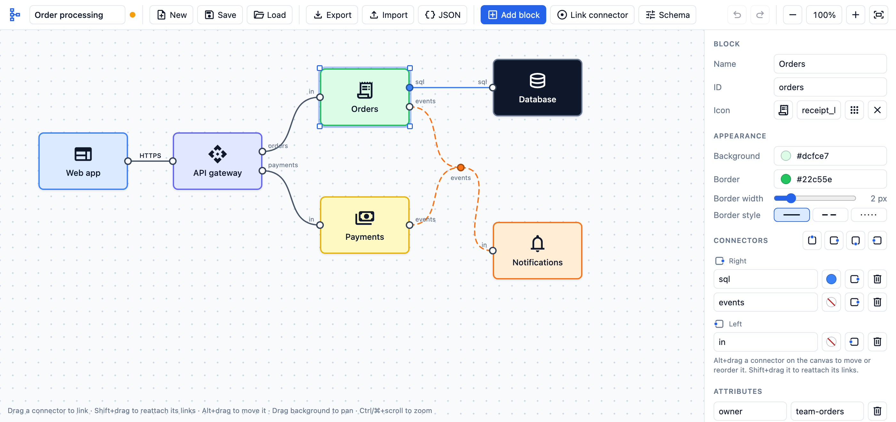

# Schematic

Version 1.0

A browser-based editor for drawing schemas made of blocks and the links between them.
Plain HTML, CSS and JavaScript: no build step, no server, no dependencies.

New to the tool? See the illustrated guide: [Working with Schematic](docs/guide.md).

## Running

Open `index.html` in a browser.

Icons come from the Material Symbols font on Google Fonts, so they need an internet connection.
Everything else works offline.

## Features

### Blocks

- Rounded rectangles with a name, ID, description, icon, background colour, border colour, border width and
  border style (solid, dashed or dotted).
- Any number of custom name/value attributes.
- Move by dragging; resize by dragging an edge or corner of the selected block.
- The icon sits above the name. When a block is too small for both, only the icon is shown, centred.
- A name can have several lines: press Enter in the Name field to start a new one.
- Icons are picked from a searchable grid or typed in by their Material Symbols name.
- The ID follows the name (lower case, words joined by dashes, numbered if already taken) until you
  type one yourself; clearing the ID field makes it follow the name again. IDs are always unique.
  The same applies to links, titles, frames and link connectors.

### Connectors

- Small circles on any side of a block, spread evenly along that side.
- Optional name, shown next to the connector, and optional colour.
- Added per side from the block panel, where they are listed grouped by side.
- Moved to another side from the panel, or by Alt+dragging on the canvas (which also reorders them).

### Links

- Drag from one connector to another to link them.
- Links are curves that meet each connector at a right angle to its side. The schema parameters
  can switch all links to straight lines or to right-angled polylines instead.
- Shift+drag from a connector to pick up the link ends attached to it and drop them on another connector.
  If some of those links are selected, only they move; otherwise all of them do.
- Each link has a name (drawn on the link), an ID, a description, a colour, a line style (solid, dashed or dotted)
  and custom attributes.
- Colour priority: the link's own colour, then its group's links colour, then the colour of a block
  connector it ends at, then the colour of a link connector it ends at. Two block connectors (or two
  link connectors) with different colours give a black link.
- A new link starts with the colour of the connector it is drawn from. From an uncoloured link
  connector it takes the colour its existing links share. Such links keep following that connector's
  colour when it changes. A link connector created by a Shift-drop takes the same colour, and the
  name of the connector the link was drawn from (and its border colour, if that is a link connector).
- White and very pale links get a thin grey edge so they stay visible.
- A small eyedropper button beside a connector's colour (and a link connector's) gives it the colour
  of a link attached to it; if the attached links differ in colour, each click picks the next one.
  With several elements selected it does this for all their connectors at once.

### Link connectors

- A free-standing dot, like a block's connector but placed anywhere on the canvas.
- Any number of links can start or end at it, all meeting in one point.
- Created from the toolbar, or by holding Shift while dropping a new link on empty canvas: a preview
  dot shows where the link connector will appear, with the link attached.
- With several link connectors selected, Shift+drag from one of them onto empty canvas extends them
  all: each gets a new link connector with the same name and colour, laid out the same way, linked
  to it, and the new links are put into a link group. The new set is selected, so it can be extended again.
- Links leave it at a right angle: left or right by default, or up or down if set so.
  Each link meeting there can also be given its own side (left, right, up or down).
- It has a name, ID, description, colour, border colour and custom attributes; its colour is passed on to its links unless a block connector
  at the other end has a colour of its own.
- Drag from the dot to start a link; drag its arrows handle, or Alt+drag the dot, to move it.

### Titles

- Free text placed anywhere on the schema, with no border or background.
- Text (one or several lines), size, colour and alignment are set in the panel; the box is moved and
  resized like a block.

### References to other schemas

- A reference stands for a block of another saved schema: choose the schema and the block (by its
  name and ID) in the panel, and the reference takes on that block's look and connectors.
- Links can be drawn between a reference's connectors and anything in this schema.
- The button in its corner (or **Open its schema** in the panel) saves the open schema and goes to
  the other one, with the original block selected.
- When a schema is saved, every block or link connector linked to a reference appears in the other
  schema as a reference too, linked to the original block the same way. These follow the schema they come
  from: remove the link there and they disappear here on its next save.
- References are found by schema name and block ID, so renaming either breaks them until they are
  chosen again; a broken reference is shown faded.

### Comments

- A sticky note with free text, for remarks about the schema: a coloured sheet with a folded corner.
  Comments always lie on top of everything else.
- Text (one or several lines), colour and text size are set in the panel; the note is moved and
  resized like a block. It has no connectors.

### Frames

- A titled rectangle drawn beneath all other elements, with its title in the top-left corner.
- Whatever lies entirely inside a frame moves with it; the frame can be resized without moving its contents.
- Background and border are set as for blocks. By default there is no background and the border is solid grey.
- A frame is selected and dragged by its title or border; the inside stays free for the elements in it.
- Pressing F while drawing a selection box (Shift+drag), or right after it, puts a frame exactly
  where the box is. With elements selected another way, F frames them with a margin.

### Clones

- Clone a block to get linked copies that always change together: name, icon, colours, size,
  attributes and connectors are shared; ID, position and links are individual.
- A connector cannot be removed while any clone has a link on it.
- A clone can be detached to become an independent block. Duplicate makes an independent copy straight away.

### Link groups

- Select several links (Shift+click) and group them into a group block.
- Grouped links run into the left side of the group block and out of its right side, without connectors.
  A group can be set to vertical instead, so links come in at the top and leave at the bottom.
- When the connectors that a group's links end at, on one side of the group, lie in one horizontal
  or vertical line, a frame is drawn around them: a rectangle with round ends, in the group's border
  colour. This can be switched off in the schema parameters.
- Dragging such a frame moves the link connectors in it together (connectors on blocks stay put).
- A group can be shown in a minimal form instead: no block, just a single link between the frames
  around the two sets of connectors. The group's name sits on that link in a small tag; the link
  runs through the tag, so dragging the tag reroutes the link. Clicking the tag or the link selects the group.
- The frames, and the single link of a minimal group, have their own colour and line width, set on
  the group; without a colour they take the group's border colour.
- The group block has the usual block settings (name, icon, colours, attributes) and can set a colour
  for all its links or for each one.
- Links can be moved into or out of a group; ungrouping removes the block and keeps the links.

### Trace

- **Trace** in the toolbar (or the T key) turns tracing on and off.
- While it is on, hovering a connector or a link marks the whole path that shares its name: links
  and connectors of that name, continuing through a block from one connector to its others of the
  same name. Other links fade back.
- **Ignore names** (under Schema → Trace) marks every link joined to the hovered one through shared
  connectors, whatever anything is called; such a path ends at blocks instead of running through them.
- Unnamed links and connectors do not break a path; a differently named one ends it. Names are
  compared ignoring case. A link connector's name is the name of its dot.

### Schema parameters

- Corner radius for all blocks.
- Link style for all links: curved, straight, or polyline (straight runs with right-angled turns),
  and how strongly curved links bend. Polyline links have slightly rounded corners; unrelated ones
  that would run along the same line, or nearly, are spaced apart, while links from the same
  connector (or to the same one) share one line and fork from it.
- Whether a link goes around its own block when its other end lies behind the side its connector
  is on (for example from a block's left side to something on its right), rather than under the block.
- Line width of all links, and the size of all link connectors.
- Whether lined-up connectors of grouped links get a frame.
- Defaults for link groups: shown as a block or as a single link, frame colour and frame width.
  They apply to every group that does not set its own.
- Colour and width of the trace mark. With no colour there is no mark and the other links just
  fade; **Same as link** marks each link in its own colour, making traced links bolder.
- A colour palette stored with the schema and offered wherever a colour is chosen.
  Colours can be added and removed.

### Storage

- Save schemas by name to browser local storage. The arrow at the end of the schema name
  drops down a list of them to pick from; **Manage saved schemas…** at its end opens the dialog for deleting, exporting and
  importing them and for choosing a folder.
- In Chrome or Edge, schemas can live in a folder on the computer instead: one JSON file per
  schema, in the export format. Pick the folder with the toolbar's folder button (or in the manage
  dialog); a schema that has been saved once is then written again automatically after every change.
  After a reload the browser may ask once to confirm access to the folder.
- If the open schema's file is changed from elsewhere (the same folder used on another computer
  through file sync, or another program), the app notices when its window is returned to and
  before each save. It loads the new version, or, if there are unsaved changes here as well, asks
  which version to keep.
- The working copy is kept automatically, so a reload does not lose unsaved edits.
- Export to a JSON file and import it back.
- Every schema file records the app that wrote it (`app`: name, version and repository address)
  and when the schema was created and last modified (`created`, `modified`, as ISO timestamps).
- Export the whole schema as a PNG picture or a one-page PDF, on white, at twice screen resolution,
  without the grid or selection marks.
- **Export all** (in the manage dialog) writes every saved schema to one file; importing that file
  adds them all back to the saved schemas.
- A JSON dialog shows the schema as text and applies edits made there.

### Canvas

- Pan by dragging the background; zoom with the scroll wheel or the toolbar; Shift+scroll also pans; fit the schema to the view.
- Shift+drag on empty canvas draws a selection box; Shift+click adds or removes single elements.
  Dragging one selected element moves them all, and Delete removes them all.
- Several selected elements share one panel for their common settings: background, border, border
  width and style for blocks and frames; colour, border and link direction for link connectors;
  size, colour and alignment for titles. A setting they differ on is shown as "mixed", and choosing
  a value gives it to all of them.
- Several selected elements can be aligned (left, centre, right, top, middle, bottom) or spread with
  equal gaps, horizontally or vertically, from the panel.
- Ctrl/⌘+C, X and V copy, cut and paste the selected elements (blocks, link connectors, titles,
  comments, frames) together with the links between them, also into another schema or tab.
- Blocks snap to a 10 px grid; hold Alt to move or resize freely.
- Resizing a block or a link group block straight after adding it makes that the size of the next
  new ones; the size is remembered by the browser.
- Undo and redo.
- Light and dark mode, switched from the toolbar; it starts in the system's mode and remembers the
  choice. Colours given to elements stay as set, and exported pictures are always on white.

## Keyboard and mouse

Letter shortcuts go by the key's position, so they also work with a non-Latin keyboard layout switched on.

| Action | Shortcut |
| --- | --- |
| Add a block | Double-click the canvas |
| Rename a block | Double-click it |
| Link two connectors | Drag from one to the other |
| New link ending in a new link connector | Drag from a connector, hold Shift, release on empty canvas |
| Reattach links to another connector | Shift+drag from the connector they are on |
| Extend several selected link connectors with a grouped set of links | Shift+drag from one of them onto empty canvas |
| Move or reorder a connector | Alt+drag it |
| Move a link connector | Drag its arrows handle, or Alt+drag the dot |
| Select several elements | Shift+drag on empty canvas, or Shift+click them |
| Select several links | Shift+click (or Ctrl/⌘+click) |
| Frame the selection box just drawn (or the selected elements) | F |
| Group selected links | Ctrl/⌘+G |
| Copy / cut / paste selected elements | Ctrl/⌘+C / Ctrl/⌘+X / Ctrl/⌘+V |
| Duplicate the selected block | Ctrl/⌘+D |
| Delete the selection | Delete or Backspace |
| Undo / redo | Ctrl/⌘+Z / Ctrl/⌘+Shift+Z |
| Save | Ctrl/⌘+S |
| Trace paths by name on hover | T |
| Ignore the grid | Hold Alt while dragging |
| Zoom | Scroll (or pinch on a trackpad) |
| Pan | Drag the background, or Shift+scroll |

## Files

- `index.html` — page structure, toolbar and dialogs
- `style.css` — styling
- `app.js` — the whole application
- `docs/guide.md` — illustrated guide to working with the tool
