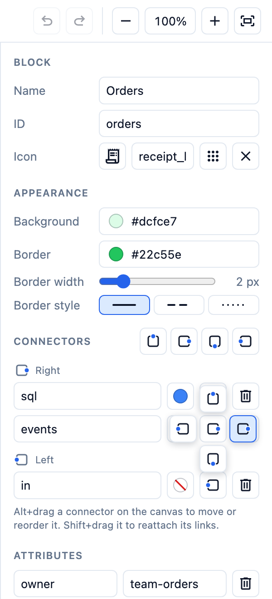
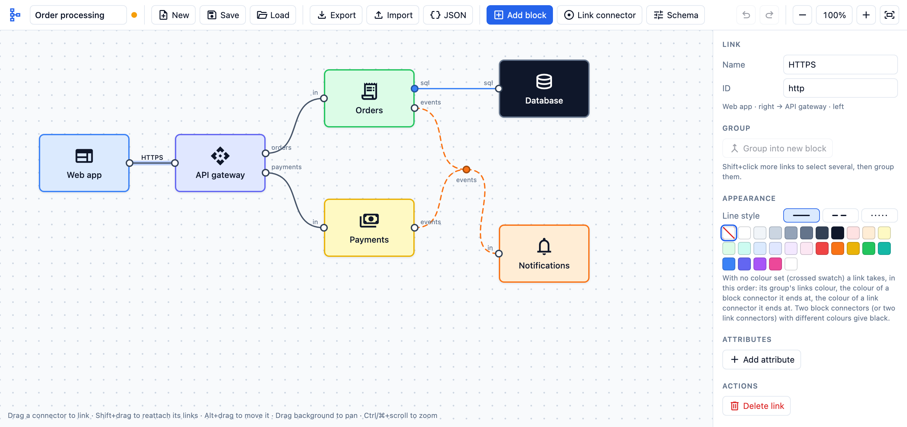
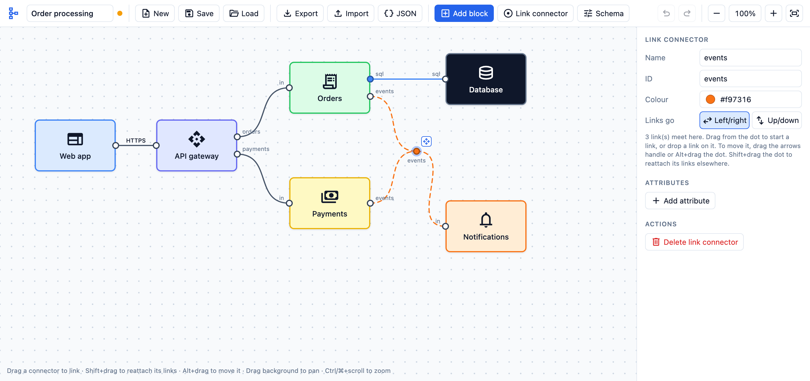
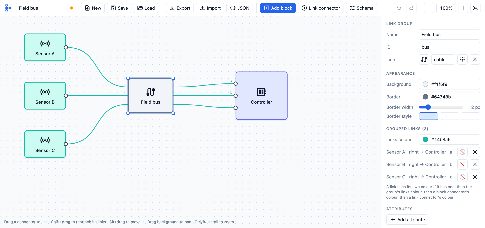
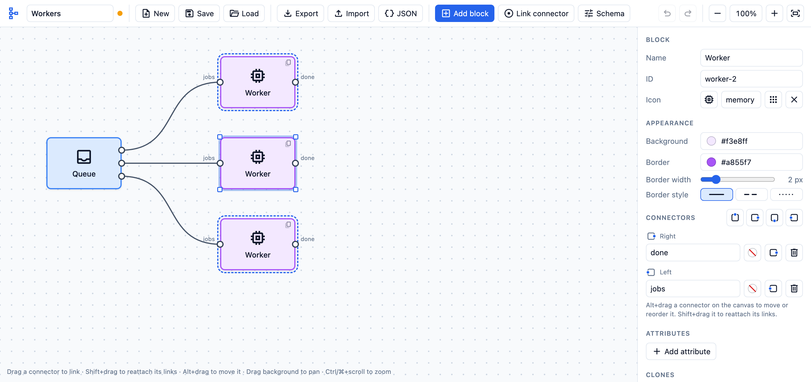
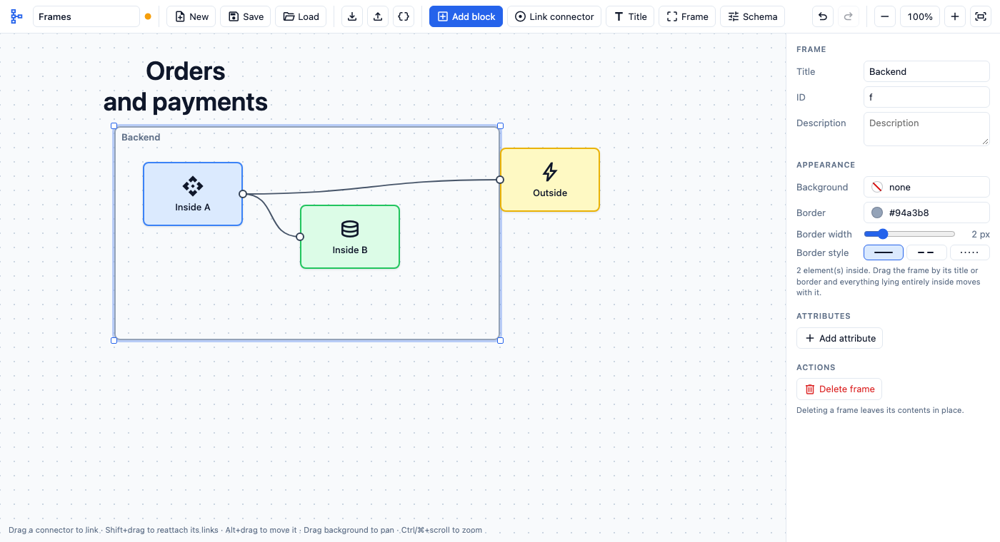
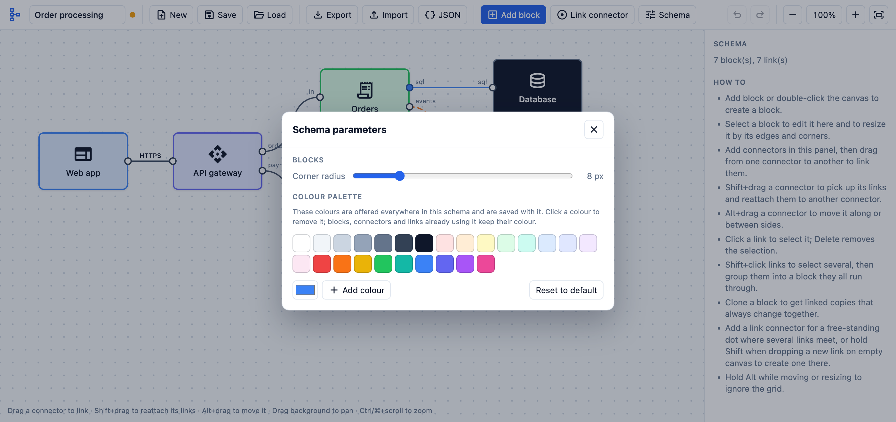
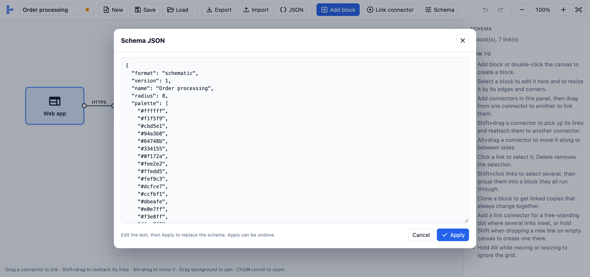

# Working with Schematic

A short tour of the tool. For the full feature list and shortcuts see the [README](../README.md).

The screen has three parts: the **toolbar** at the top, the **canvas** in the middle, and the
**panel** on the right, which shows the settings of whatever is selected.

## 1. Add blocks

- Press **Add block**, or double-click empty canvas.
- Drag a block to move it. Select it and drag an edge or corner to resize it.
- In the panel set its **Name**, **ID**, **Description** and **Icon** (pick from the grid or type a Material Symbols name).
- Under **Appearance** click **Background** or **Border** to open the palette, and set the border
  width and style (solid, dashed, dotted).
- **Attributes** holds any extra name/value pairs you want to keep with the block.

Blocks snap to a grid; hold Alt while dragging to place them freely.

To move several elements at once, Shift+drag on empty canvas to draw a selection box around them
(or Shift+click them one by one), then drag any one of them. With several elements selected the panel also
offers **Align** and **Spread** buttons to line them up or space them evenly.

## 2. Add connectors

Connectors are the dots on a block's sides that links attach to.

- The four buttons beside the **Connectors** title add a connector on the top, right, bottom or left.
- Each connector row has a name, a colour button, a side button and a delete button.
- Click the side button to open four choices around it and move the connector to another side.
- On the canvas, Alt+drag a connector to move it along a side or onto another one.

Connectors on the same side are always spread evenly.

## 3. Draw links

- Drag from one connector to another to link them.
- Click a link to select it. Its panel has a **Name** (shown on the link), **ID**, line style,
  colour and attributes.
- To move a link to a different connector, Shift+drag from the connector it is on and drop on the new one.
- Delete or Backspace removes the selected link or block.

A link with no colour of its own takes one from what it is attached to, in this order: its group,
a block connector, a link connector. If two block connectors at its ends have different colours,
it is drawn black.

To follow a signal across the schema, turn on **Trace** in the toolbar (or press T) and hover a
connector or a link: every link and connector on the path sharing its name is marked, also where
the path runs through a block between two connectors of the same name. Unnamed links in between
belong to the path.

## 4. Join links at a link connector

A link connector is a free-standing dot where several links meet, such as the orange "events"
point below.

- Press **Link connector** in the toolbar, or drag a new link, hold Shift and release over empty
  canvas. A preview dot shows where it will appear.
- Drag from the dot to start another link, or drop a link onto it.
- Move it by its arrows handle (shown when selected) or by Alt+dragging the dot.
- **Links go** sets whether links leave it left/right or up/down. The **Links** list below it
  lets you pick a side for an individual link.

## 5. Group links

Several links can be routed through one block, for example to show a bus or a cable.

- Click a link, then Shift+click the others to select them.
- Press **Group into new block** in the panel (or Ctrl/⌘+G).
- The links now enter the group block on the left and leave on the right. The block can be named,
  coloured and resized like any other, and **Links colour** colours all its links.
- **Ungroup links** removes the block and leaves the links in place.

## 6. Clone blocks

Use **Clone** when the same thing appears several times and must stay identical.

- Changing the name, icon, colours, size, attributes or connectors of one clone changes all of them.
  The other clones are outlined while one is selected.
- Each clone keeps its own ID, position and links.
- A connector cannot be removed while any clone has a link on it.
- **Detach from clones** turns one into an independent block. **Duplicate** makes an independent copy.

## 7. Add titles and frames

- **Title** adds free text with no border. Set the text, size, colour and alignment in the panel.
- **Frame** adds a titled rectangle that sits behind everything else. Drag it by its title or border
  and whatever lies entirely inside moves with it; resize it by its edges and corners once selected.
- A frame has no background and a grey border by default; both are set as for a block.

## 8. Schema-wide settings

The **Schema** button opens the parameters that apply to the whole schema: the corner radius of
all blocks and the colour palette offered wherever a colour is chosen.

Click a palette colour to remove it, or pick a new one and press **Add colour**.

## 9. Save, share and edit as text

- **Save** stores the schema in the browser under its name; **Load** lists saved schemas to open or delete.
- **Export** downloads a JSON file and **Import** reads one back, for moving schemas between browsers.
- In the Load dialog, **Export all** puts every saved schema into one file; importing that file
  restores them all, which is handy as a backup.
- **JSON** shows the schema as text. Edit it and press **Apply** to replace the schema; errors are
  reported under the text and nothing is applied until they are fixed.

Unsaved work is kept across reloads, and Ctrl/⌘+Z undoes any change, including an applied JSON edit.
